  

<h1 align="center">Eshaan Adyanthaya</h1>

Software Engineering | Applied ML | AI Engineering | Computer Vision & Robotics  
Integrated M.Tech @ VIT Chennai

Designing intelligent systems that move from geometry to real-world deployment.

 
<h2 align="center">Currently Building</h2>

Backend services with FastAPI  
RAG pipelines with embeddings, vector databases & hybrid search  
Applied ML & time-series forecasting  
Full-stack apps & automation

 
<h2 align="center">Systems I Work With</h2>

 
<h2 align="center">Contribution City</h2>

  

  Each building is a month · windows show daily commits · yellow = active · updates daily

 

  

<h2 align="center">Connect</h2>

 

<em>a generic coding quote</em>

